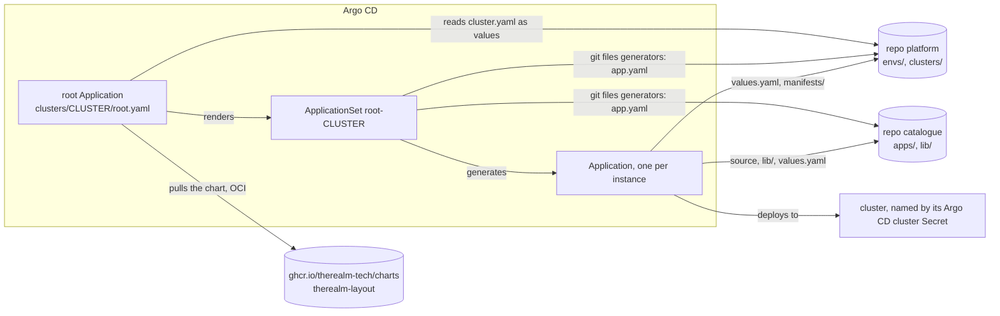
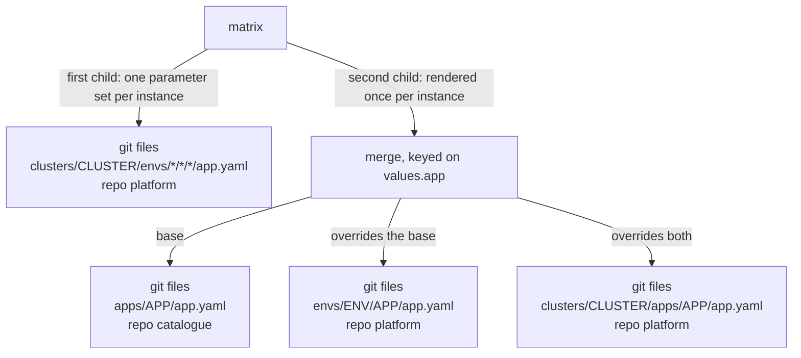

# Architecture

## Overview

[SPEC.md](SPEC.md) defines the layout: which files exist, what they mean and
how the levels of an instance combine. It is normative; the rest of the
repository implements or illustrates it.

[`charts/therealm-layout`](charts/therealm-layout) implements it for Argo CD.
A release of the chart covers one cluster and renders a single
`ApplicationSet`. Argo CD's ApplicationSet controller then reads the repo
catalogue and the repo platform with git generators and generates one
`Application` per instance of that cluster.

[`example/`](example/) is a repository following the layout, with both roles
held by one repository. It is what the chart is rendered against, and what
[SPEC.md's Appendix A](SPEC.md#appendix-a-worked-example) describes.

[`trlctl`](https://github.com/therealm-tech/trlctl), which scaffolds and
validates repositories against the specification, lives in its own
repository.

## Components

- **[`templates/application-set.yaml`](charts/therealm-layout/templates/application-set.yaml)**
  builds the `ApplicationSet`: its generators, from `cluster`, `repo.catalog`
  and `repo.platform`, and its template, from the `application` values. It
  owns everything decided at Helm render time.
- **[`files/template.yaml`](charts/therealm-layout/files/template.yaml)** is
  the static part of the `ApplicationSet` template: the fields every
  `Application` has, whatever its effective `app.yaml`.
- **[`files/template-patch.yaml`](charts/therealm-layout/files/template-patch.yaml)**
  is the `templatePatch`: every field that depends on the effective
  `app.yaml`, which Argo CD renders once per instance.
- **[`templates/_helpers.tpl`](charts/therealm-layout/templates/_helpers.tpl)**
  writes the ApplicationSet expressions the other two need: the shortened
  names of SPEC.md Section 8.4, and the chart values declared as literals at
  the top of the patch.
- **`clusters/<cluster>/root.yaml`** is the bootstrap manifest of an Argo CD
  instance: one root `Application` per cluster it manages, each rendering the
  chart from the registry. The specification reserves the name and leaves its
  content to the deploying system; the example's
  [`root.yaml`](example/clusters/mgmt-1/root.yaml) is one.

## Data flow

The resolution of SPEC.md Section 10 maps onto the generators as follows.

- **Instances.** The first matrix child lists every instance `app.yaml` of
  the cluster, at `repo.platform.revision`. `env`, `app` and `instance` come
  from the segments of the file's path, offset by the depth of
  `repo.platform.path`.
- **`app.yaml` levels.** For each instance, the merge child reads the
  catalogue, env and cluster×app `app.yaml` of its app. The catalogue file is
  the merge base: an instance of an app missing from the catalogue yields no
  parameter set, and no `Application`. A missing env or cluster×app file
  contributes nothing. The matrix then lays the instance's own `app.yaml` over
  the merged result. Both steps merge parameters recursively: nested mappings
  combine key by key, scalars, sequences and null are replaced whole.
- **Source.** The patch reads the effective `app` mapping, where a key
  holding null counts as unset: `chart` or `path`, `url` and `revision`, or
  the catalogue's URL and revision with the catalogue's layout root
  prepended to `path` when `url` is not set. A Helm
  source gets the four levels' `values.yaml` as value files, through `ref`
  sources named `catalog` and `platform`. A source `apps/<app>/jsonnet` gets
  the catalogue's `lib/` as its Jsonnet library path, and `lib/` among the
  `argocd.argoproj.io/manifest-generate-paths` of its `Application`, so a
  commit to a shared library refreshes the apps that can import it.
- **Instance manifests.** A last source points at the instance directory of
  the repo platform, filtered to its `manifests/` by `application.manifests`.

## Design decisions

- **Only Argo CD objects.** The chart renders an `ApplicationSet` and nothing
  else: resolution runs in Argo CD's own ApplicationSet controller and repo
  server, with no plugin, sidecar or controller of its own to deploy and
  keep compatible. The cost is that the merge semantics are those of the
  generators, and the specification's rules have to be expressible in them.
  Null is one of them: the generators let a null at a more specific level
  remove a key, and SPEC.md adopts that rather than have the patch merge
  the levels itself, from each level's `app` passed separately.
- **One release per cluster, no clusters generator.** Each release names its
  cluster, and every `Application` targets it by name through
  `destination.name`. A cluster missing from Argo CD shows up as failing
  `Application`s, rather than as no `Application`s at all.
  Each cluster's `cluster.yaml` stays its own values file, so two clusters can
  read different revisions of the repo catalogue.
- **Static template, dynamic patch.** `template` has a fixed structure: its
  values are templated, but a field cannot be added or left out per
  instance. `templatePatch` is a Go template rendered per instance, so every
  field that depends on the effective `app.yaml` lives there. Both live under `files/`,
  read verbatim, so Helm never evaluates the ApplicationSet syntax they hold.
- **Multi-source `Application`s.** One `Application` carries the app's source,
  the two `ref` sources its Helm values are read through, and the instance's
  `manifests/`. Each file is read from the repository and at the revision
  SPEC.md Section 4 assigns to it, without copying anything between
  repositories.
- **Jsonnet recognised by its path.** Argo CD only takes a Jsonnet library
  path through the source's `directory` field, and any `directory` turns off
  its detection of the source type: a Kustomize source given one is rendered
  as plain YAML. The chart sees `app.yaml`, not the content of the source
  directory, so it cannot tell a Jsonnet `manifests/` from a Kustomize one.
  SPEC.md reserves `apps/<app>/jsonnet` for Jsonnet, as it reserves
  `apps/<app>/charts/<chart>` for Helm, and the chart sets the library path
  on that path only. A Jsonnet source in `manifests/` keeps Argo CD's
  detection and has no shared libraries.
- **A published chart.** The chart is released as a public OCI artefact, so a
  repository following the layout depends on a pinned chart version rather
  than on a copy of the chart, and Argo CD pulls it without credentials.

## Invariants and constraints

- SPEC.md is the reference: where the chart and the specification disagree,
  the chart is wrong.
- Every generated `Application` deploys to the release's cluster: no content
  of either repository may change its destination cluster.
- The default `Application` and Helm release names follow SPEC.md
  Section 8.4: at most `names.maxLength` characters, shortened with a SHA-256
  suffix past it.

## Limitations

- The chart does not validate the layout: a file that breaks a MUST of
  SPEC.md surfaces as an `Application` that fails to generate or to sync, not
  as an error naming the rule. `trlctl validate` is where the rules are
  checked.
- An instance whose app is missing from the catalogue generates no
  `Application` and reports no error.
- Shared Jsonnet libraries reach only sources held by the repo catalogue.
  Argo CD resolves a Jsonnet library path in the repository of the source,
  so a source whose `url` names another repository cannot read the
  catalogue's `lib/`.
